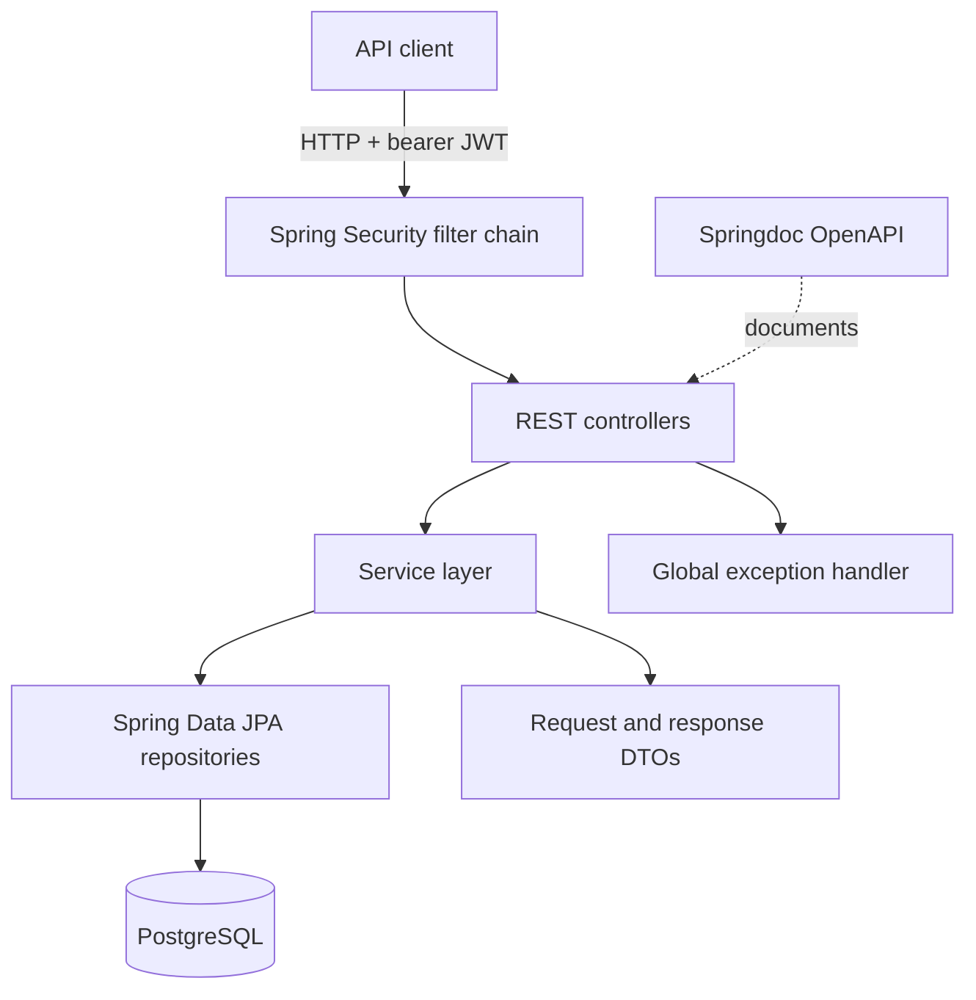

# Engineering Approach: Employee Salary Management

This document captures the requirements, implementation plan, architecture, AI assistance approach, design trade-offs, and performance considerations for the current employee salary management service. It is based on the code in this repository as inspected on 2026-11-05. Where a behavior is a recommendation or an assumption rather than an implemented feature, it is labeled accordingly.

## 1. Requirements

### Product goal

Provide a backend service for managing employee and organizational records, attendance and leave, salary components, payroll periods, payroll generation, and payment status. Protect sensitive operations with authentication and role-based access.

### Functional requirements

| Area | Requirement | Current implementation evidence |
|---|---|---|
| Authentication | Authenticate users and issue JWT-based access for stateless API requests. | Auth service, JWT classes, and Spring Security filter chain. |
| Authorization | Restrict employee, organization, attendance, leave, salary, and payroll APIs by role. | Route authorization rules in `SecurityConfig`. |
| Employee administration | Create and access employee records and associate them with organizational data. | Employee controller/service/repository and employee entities/DTOs. |
| Organization | Manage departments and designations. | Department and designation controllers/services/repositories. |
| Time and leave | Record attendance and handle leave requests. | Attendance and leave controllers/services/repositories. |
| Salary setup | Maintain salary components assigned to employees. | Salary controller/service and salary component entities/repositories. |
| Payroll | Generate a payroll record for an employee and period, calculate gross/net amounts, retrieve records, and update payment status. | `PayrollServiceImpl`; duplicate generation is rejected at the service layer. |
| API errors | Return a consistent API error representation for handled failures. | Global exception handler and API error DTO. |
| API discovery | Publish OpenAPI documentation with a bearer authentication scheme. | Springdoc dependency and OpenAPI configuration. |

### Quality requirements

- Keep the API stateless and authenticate protected endpoints with JWTs.
- Preserve money as decimal values (`BigDecimal`), avoiding binary floating-point calculations.
- Keep business logic in services and persistence behind repositories.
- Validate external input and return understandable errors.
- Treat employee and payroll data as sensitive; expose only required response fields and limit access by role.

### Scope notes and open requirements

- The repository does not define a complete payroll policy (tax, overtime, proration, rounding, currency, or statutory deductions). The current generation path adds basic salary and allowance components, subtracts deduction components, and stores a `PENDING` payroll. Policy-specific calculations require explicit business rules.
- The present payroll generation path uses employee salary as a fallback unless a BASIC/BASE component exists. It does not incorporate attendance, leave, tax, or proration.
- Payroll idempotency is checked in application code. A database uniqueness constraint on employee and payroll period is a recommended safeguard against concurrent duplicate requests; confirm the intended one-payroll-per-employee-per-period rule before enforcing it in schema.
- The standalone `PayrollCalculator` currently has no implementation; calculation is presently in `PayrollServiceImpl`.

## 2. Planning and design notes

### Delivery sequence

1. Map the domain: users/roles, employees, departments/designations, attendance/leave, salary components, payroll periods, and payroll records.
2. Define API contracts with request/response DTOs and validation at controller boundaries.
3. Implement repository-backed service operations and transactional writes.
4. Add authentication and role checks around protected routes.
5. Centralize expected error mapping and expose API documentation.
6. Add focused tests for domain calculations, authorization, validation, and persistence behavior as each feature is completed.

### Design choices visible in the code

- Spring MVC controllers provide HTTP boundaries; service interfaces and implementations hold application behavior; Spring Data repositories handle persistence.
- JPA entities represent persisted state while DTOs shape API inputs and outputs.
- Payroll generation is transactional and snapshots calculated totals into a payroll record, so later salary component changes need not silently rewrite an already generated payroll.
- JWT authentication uses a stateless security session policy. Role restrictions are expressed at route level.
- `BigDecimal` is used for payroll money values.

### Suggested follow-up work

- Move payroll arithmetic into the existing `PayrollCalculator` as a pure, independently testable component, keeping data retrieval and persistence in the service.
- Define and document money scale/rounding and currency policy before adding tax or statutory calculations.
- Use a database constraint plus a conflict-aware service response to enforce payroll uniqueness under concurrent requests.
- Add domain-specific exceptions and map them consistently to appropriate HTTP statuses.
- Add focused unit and integration coverage; the current test tree contains only the application context test scaffold.

## 3. Architecture



### Request flow

1. The JWT filter examines the bearer token and establishes the authenticated principal for protected requests.
2. Spring Security checks the route's role requirements.
3. A controller accepts the request and delegates to a service.
4. The service applies business rules and calls repositories inside transaction boundaries where needed.
5. The service returns a DTO; the controller serializes it as the HTTP response. Handled exceptions are shaped by the global exception handler.

### Payroll generation flow (current behavior)

```mermaid
sequenceDiagram
    participant C as Client
    participant S as PayrollService
    participant E as EmployeeRepository
    participant P as PayrollPeriodRepository
    participant SC as EmployeeSalaryComponentRepository
    participant PR as PayrollRepository
    C->>S: generatePayroll(employeeId, periodId)
    S->>E: find employee
    S->>P: find payroll period
    S->>PR: check existing employee-period payroll
    S->>SC: load employee salary components
    Note over S: Basic + allowances = gross; gross - deductions = net
    S->>PR: save PENDING payroll
    S-->>C: PayrollResponse
```

## 4. AI tool prompts and usage

No AI-generated code prompt history is checked into this repository. For transparent future use, a suitable prompt for a review pass on this document or related implementation is:

> Review this employee salary management service against the repository's actual code. Separate implemented behavior from assumptions and recommendations. Identify correctness, security, and maintainability risks; do not invent business rules. For each finding, cite the relevant class or method and propose the smallest practical next step. Do not modify files unless explicitly asked.

AI output should be treated as a review aid: verify claims against source, confirm payroll policy with a domain owner, and run project checks before accepting code changes. Do not provide real employee records, credentials, signing keys, or production tokens to an AI tool.

## 5. Trade-offs

| Decision | Benefit | Cost or risk | Current stance / next step |
|---|---|---|---|
| Modular monolith instead of microservices | Simple deployment and transaction boundaries; domain modules remain easy to navigate. | Modules share a release and runtime; scaling is not independent. | Appropriate for the current repository size. Split only when operational or team boundaries justify it. |
| JWT and stateless requests | No server-side session affinity; fits a REST API. | Revocation, signing-key rotation, and token lifetime need careful handling. | Keep tokens short-lived and protect secrets; review blacklist storage and lifecycle for multi-instance deployment. |
| JPA repositories | Productive persistence and clear entity relationships. | Lazy-loading surprises and N+1 queries can arise; ORM behavior needs query awareness. | Use fetch plans/projections for list endpoints when measurements or query inspection show a problem. |
| Calculate payroll synchronously | Simple user feedback and atomic persistence. | Large payroll runs can hold a request open and consume database connections. | Suitable for small runs; consider batch/job processing with progress and retry semantics if volume grows. |
| Snapshot totals in payroll records | Historical payroll remains stable when employee setup changes. | Corrections require an explicit adjustment or regeneration policy. | Preserve auditability; define correction and approval workflows before production use. |
| Calculation logic currently resides in service | Keeps current implementation straightforward. | Harder to test independently; service mixes lookup, policy, and persistence. | Extract a pure calculator and test policy boundaries as follow-up work. |

## 6. Performance considerations

- **Database access:** Payroll generation loads the employee, period, existing payroll list, and employee salary components. Prefer an existence query for the duplicate check instead of materializing a list, and ensure repository methods use indexed foreign keys.
- **Batch payroll:** The current API appears to generate one employee-period payroll at a time. For a whole-period run, avoid one query round trip per employee; batch-load employees/components, write in chunks, and choose transaction size based on measured database limits.
- **Pagination:** `getAllPayrolls()` currently maps all records into memory. Add bounded pagination before payroll history becomes large; apply the same approach to other unbounded collection endpoints.
- **Associations and serialization:** Return DTOs rather than serializing JPA entities. Review list queries for N+1 access to employee/department relationships and fetch only fields needed by the response.
- **Indexes and uniqueness:** Index common lookup keys (employee ID, period ID, status/date where queried). A unique employee-period constraint can make duplicate protection reliable under concurrency if it matches business rules.
- **Caching:** Payroll data is sensitive and usually requires fresh values. Avoid broad caching; consider caching only stable reference data such as designations if profiling demonstrates repeated read pressure and invalidation is well-defined.
- **Observability:** Use actuator health/metrics and structured logs without logging tokens, passwords, or unnecessary salary details. Measure request latency, database query time, and payroll batch duration before optimizing.
- **Capacity validation:** Establish expected employee count, payroll run window, and concurrent request volume. Benchmark representative database and application workloads before setting pool sizes or introducing asynchronous processing.

## 7. Validation status

This is a documentation artifact derived from source inspection. It does not claim that the recommendations above are implemented or that the application has passed a build or test run. The existing test source contains an application context test scaffold; add targeted tests for the rules and risks described here as implementation proceeds.

## 8. API response and validation conventions

The API should validate request bodies and parameters at the HTTP boundary, and return consistent, user-readable feedback. The shared error shape is:

```json
{
  "timestamp": "2026-11-05T12:00:00Z",
  "status": 400,
  "error": "Validation error",
  "message": "Please correct the highlighted fields and try again.",
  "path": "/api/example",
  "validationErrors": { "field": "A field-specific explanation." }
}
```

Use `201 Created` with a success message for creates, `200 OK` with an “Updated successfully” message for updates, and `200 OK` with an “Employee deleted successfully” message for employee deletion. Reads should return `200 OK` and the requested data. Authentication failures should return `401 Unauthorized` with a sign-in instruction; authenticated callers without the required role receive `403 Forbidden`. Invalid input should return `400 Bad Request` with `error: "Validation error"` and per-field messages. Missing resources should return `404 Not Found`; duplicate/conflicting data should return `409 Conflict`; unexpected failures should return a generic `500` message without exposing internal exception details.

The implementation now has a shared structured error response, centralized handlers for bean validation, malformed bodies, business input errors, conflicts and unexpected failures, plus JSON security responses for 401/403. Login fields use bean validation. Applying field constraints and `@Valid` consistently to every endpoint, adding success-message envelopes to every controller, and mapping missing resources to 404 remain follow-up implementation work; this convention is the target contract, not a claim that all endpoints already meet it.
